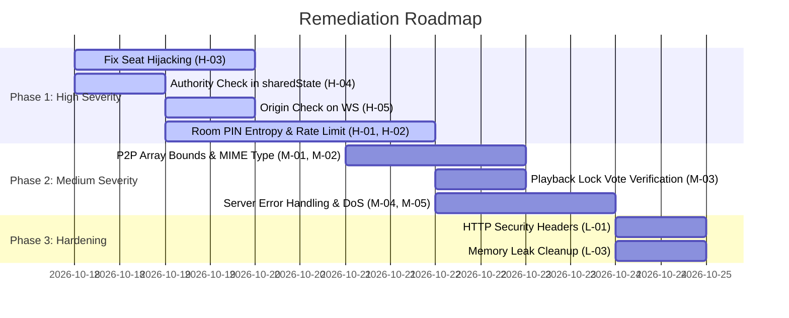

# 3RTC Security Audit & Vulnerability Assessment Report

**Audit Date:** October 2026  
**Auditor Role:** Senior Cybersecurity Engineer & Application Penetration Tester  
**Target Codebase:** [3RTC](file:///c:/Users/dvana/Documents/3RTC) (WebRTC P2P Watch Party & Signaling Engine)  
**Scope:** Backend Signaling Server ([server/](file:///c:/Users/dvana/Documents/3RTC/server)), Frontend Client ([client/](file:///c:/Users/dvana/Documents/3RTC/client)), WebRTC Protocols, Infrastructure Deployments & Configurations.

---

## 1. Executive Summary

A comprehensive, source-code-assisted security audit was performed across the **3RTC** application. The system implements a peer-to-peer watch party platform leveraging WebSockets for signaling and WebRTC DataChannels/MediaStreams for P2P video, audio, chat, and room state synchronization.

While the codebase demonstrates good engineering practices in several areas (such as HMAC-SHA256 tokens for seat/host persistence, timing-safe equality checks, and sanitization of display names), multiple significant security vulnerabilities were identified. These span **room authentication, authorization boundaries, Denial of Service (DoS) resilience, input sanitization in P2P binary protocols, and network privacy**.

Below is a consolidated summary of all findings categorized by severity.

---

## 2. Findings Matrix

| ID | Severity | Title | Affected File / Component | Category |
| :--- | :--- | :--- | :--- | :--- |
| **H-01** | **HIGH** | 5-Digit Room PIN Enumeration & Mass IP Address Harvesting | [server/signaling.js](file:///c:/Users/dvana/Documents/3RTC/server/signaling.js) | Auth / Privacy |
| **H-02** | **HIGH** | Total Signaling Denial of Service via Room Pool Exhaustion | [server/signaling.js](file:///c:/Users/dvana/Documents/3RTC/server/signaling.js) | DoS / Resource |
| **H-03** | **HIGH** | Host Privilege Hijacking via Tokenless Unoccupied Seat Reclaim | [server/signaling.js](file:///c:/Users/dvana/Documents/3RTC/server/signaling.js) | Privilege Escalation |
| **H-04** | **HIGH** | Arbitrary Shared State Injection & Desynchronization in Bus | [client/src/core/sharedState.js](file:///c:/Users/dvana/Documents/3RTC/client/src/core/sharedState.js) | Authorization |
| **H-05** | **HIGH** | Missing Origin Validation (Cross-Site WebSocket Hijacking - CSWSH) | [server/signaling.js](file:///c:/Users/dvana/Documents/3RTC/server/signaling.js) | CSRF / WebSocket |
| **M-01** | **MEDIUM** | Client Crash / DoS via Unbounded Binary Chunk Allocations | [client/src/utils/p2pImageShare.js](file:///c:/Users/dvana/Documents/3RTC/client/src/utils/p2pImageShare.js), [p2pStreamer.js](file:///c:/Users/dvana/Documents/3RTC/client/src/utils/p2pStreamer.js) | Memory / DoS |
| **M-02** | **MEDIUM** | Peer-Supplied MIME Type & Filename Stored XSS / Dangerous Executable Risk | [client/src/utils/p2pImageShare.js](file:///c:/Users/dvana/Documents/3RTC/client/src/utils/p2pImageShare.js), [ImageLightboxModal.jsx](file:///c:/Users/dvana/Documents/3RTC/client/src/components/ImageLightboxModal.jsx) | XSS / File Security |
| **M-03** | **MEDIUM** | Playback Lock Authorization Bypass via `byVote` Flag Tampering | [client/src/features/playback/useHostControls.js](file:///c:/Users/dvana/Documents/3RTC/client/src/features/playback/useHostControls.js) | Logic / Access Control |
| **M-04** | **MEDIUM** | Signaling Process Crash via Uncaught Exceptions in HTTP Handlers | [server/server.js](file:///c:/Users/dvana/Documents/3RTC/server/server.js) | Availability / DoS |
| **M-05** | **MEDIUM** | Unbounded WebSocket Payloads & Quick-Picks CPU Exhaustion | [server/signaling.js](file:///c:/Users/dvana/Documents/3RTC/server/signaling.js), [quickPicks.js](file:///c:/Users/dvana/Documents/3RTC/server/quickPicks.js) | Resource Exhaustion |
| **L-01** | **LOW** | Absence of HTTP Security Headers & Clickjacking Exposure | [client/vercel.json](file:///c:/Users/dvana/Documents/3RTC/client/vercel.json), [server/server.js](file:///c:/Users/dvana/Documents/3RTC/server/server.js) | Configuration |
| **L-02** | **LOW** | Mandatory Direct IP Exposure (Lack of TURN Relay Fallback) | [client/src/webrtc/config.js](file:///c:/Users/dvana/Documents/3RTC/client/src/webrtc/config.js) | Information Disclosure |
| **L-03** | **LOW** | Memory Leak from Uncollected Stale P2P Image Transfers | [client/src/utils/p2pImageShare.js](file:///c:/Users/dvana/Documents/3RTC/client/src/utils/p2pImageShare.js) | Memory Management |
| **L-04** | **LOW** | Unsafe Host Identity Fallback in `normalizeSender` | [client/src/webrtc/peerMessages.js](file:///c:/Users/dvana/Documents/3RTC/client/src/webrtc/peerMessages.js) | Logic / State |
| **L-05** | **LOW** | Headless Room State upon Guest-Initiated Rejoin | [server/signaling.js](file:///c:/Users/dvana/Documents/3RTC/server/signaling.js) | State Sync |

---

## 3. High Severity Vulnerabilities

### H-01: 5-Digit Room PIN Enumeration & Mass IP Address Harvesting

- **CWE:** CWE-307: Improper Restriction of Excessive Authentication Attempts
- **Affected Code:** [`server/signaling.js:L220-L248`](file:///c:/Users/dvana/Documents/3RTC/server/signaling.js#L220-L248)
- **Description:**
  Rooms use a 5-digit numerical code (`10000` to `99999`), meaning there are at most 90,000 possible rooms. The WebSocket server imposes **no rate limiting, no message throttling, and no authentication** on incoming `join` messages. An attacker can connect over WebSocket and sweep all 90,000 codes in a few seconds.
- **Exploitation Impact:**
  1. Once an attacker guesses or scans an active room, the server emits `{ type: 'joined', roomId, peers: [...] }` to the attacker and broadcasts `{ type: 'peer-joined', peerId }` to all occupants.
  2. Under [`client/src/webrtc/signalingMessages.js`](file:///c:/Users/dvana/Documents/3RTC/client/src/webrtc/signalingMessages.js#L75-L94), every occupant's browser automatically initiates a WebRTC connection to the newcomer and sends SDP offers and ICE candidates.
  3. WebRTC ICE candidates contain the **real public IP addresses, local LAN IP addresses, and NAT topology** of all active participants, deanonymizing and geolocating them without consent.
- **Remediation:**
  - Enforce IP-based rate limiting on `join` attempts (e.g., maximum 5 attempts per second, with exponential backoff on invalid room attempts).
  - Transition room codes from 5-digit numbers to high-entropy strings (e.g., 8–10 alphanumeric characters or UUIDs).
  - Support an optional room passcode/secret.

---

### H-02: Total Signaling Server Denial of Service via Room Pool Exhaustion

- **CWE:** CWE-400: Uncontrolled Resource Consumption
- **Affected Code:** [`server/signaling.js:L182-L194`](file:///c:/Users/dvana/Documents/3RTC/server/signaling.js#L182-L194)
- **Description:**
  When generating a room, the server attempts up to 100 random picks between 10,000 and 99,999:
  ```javascript
  let generatedRoomId;
  let attempts = 0;
  do {
    generatedRoomId = String(crypto.randomInt(10000, 100000));
    attempts++;
  } while (rooms.has(generatedRoomId) && attempts < 100);
  if (rooms.has(generatedRoomId)) {
    safeSend(ws, { type: 'error', code: 'server-busy', message: 'No free room codes right now. Try again in a minute.' });
    return;
  }
  ```
- **Exploitation Impact:**
  Because `create-room` requires no authentication or rate limiting, an attacker script can create rooms until all 90,000 slots are occupied (or collision rate makes 100 consecutive picks fail). The signaling server will then reject **all** legitimate users globally with `server-busy`, rendering the platform completely offline.
- **Remediation:**
  - Expand room ID keyspace to prevent collision-based exhaustion.
  - Enforce strict per-IP rate limits on room creation (e.g., maximum 3 rooms per IP per minute).

---

### H-03: Host Privilege Hijacking via Tokenless Unoccupied Seat Reclaim

- **CWE:** CWE-287: Improper Authentication / Privilege Escalation
- **Affected Code:** [`server/signaling.js:L39-L58`](file:///c:/Users/dvana/Documents/3RTC/server/signaling.js#L39-L58), [`server/signaling.js:L252-L291`](file:///c:/Users/dvana/Documents/3RTC/server/signaling.js#L252-L291)
- **Description:**
  In `maySit(roomId, room, peerId, ws, token)`:
  ```javascript
  function maySit(roomId, room, peerId, ws, token) {
    const holder = room.get(peerId);
    if (!holder || holder === ws || holder.readyState !== WebSocket.OPEN) return true;
    return seats.checkSeat(token, roomId, peerId) === roomInfo.get(roomId)?.epoch;
  }
  ```
  If `holder` is not currently in the room (or socket is closed/stale), `maySit` returns `true` **without verifying `token`**.
  Peer IDs are public to everyone in the room. When the room host reloads the page, navigates, or experiences a network blip, `room.get(hostPeerId)` becomes closed or null.
- **Exploitation Impact:**
  An attacker in the room (or scanning rooms) immediately sends:
  ```json
  { "type": "join", "roomId": "12345", "peerId": "<targetHostPeerId>" }
  ```
  Because `holder` is absent or not open, `maySit` returns `true`. The attacker is placed in the host's seat. Then in `tokensFor`:
  ```javascript
  ...(info.hostPeerId === peerId ? { hostToken: seats.hostToken(roomId, info.epoch) } : {})
  ```
  The server issues a cryptographically valid `hostToken` to the attacker. The attacker gains irreversible, authenticated host status, can lock the room, kick participants, and locks out the legitimate host.
- **Remediation:**
  Never accept client-supplied `peerId` upon `join` unless validated by a corresponding signed `seatToken`. If no token is provided, always assign a fresh `crypto.randomUUID()`.

---

### H-04: Arbitrary Shared State Injection & Desynchronization in `createSharedStore`

- **CWE:** CWE-345: Insufficient Verification of Data Authenticity
- **Affected Code:** [`client/src/core/sharedState.js:L115-L120`](file:///c:/Users/dvana/Documents/3RTC/client/src/core/sharedState.js#L115-L120)
- **Description:**
  In `createSharedStore`:
  ```javascript
  bus.on('room-state', (msg, fromPeerId) => {
      if (msg.key !== key) return;
      addMember(fromPeerId);
      if (typeof msg.v !== 'number' || msg.v <= version) return;
      set(msg.state, msg.v);
  })
  ```
  The receiver checks whether `msg.v > version`, but **never verifies that `fromPeerId === authorityId()`**!
- **Exploitation Impact:**
  Any non-host peer or malicious guest can broadcast `{ type: 'room-state', key: '...', v: 9007199254740991, state: { ...maliciousState } }`. All peers unconditionally accept the state. Setting `v` to `Number.MAX_SAFE_INTEGER` permanently blocks the legitimate authority from ever issuing state updates again, corrupting activities, games, or room state.
- **Remediation:**
  Ensure that incoming `room-state` messages are accepted only if `fromPeerId === authorityId()`. Reject state assertions from non-authority peers.

---

### H-05: Missing Origin Validation on WebSocket Handshake (Cross-Site WebSocket Hijacking - CSWSH)

- **CWE:** CWE-1385: Missing Origin Validation in WebSockets
- **Affected Code:** [`server/signaling.js:L19-L21`](file:///c:/Users/dvana/Documents/3RTC/server/signaling.js#L19-L21)
- **Description:**
  `WebSocketServer` is attached directly to the HTTP server without origin inspection:
  ```javascript
  export function attachSignaling(server) {
    const wss = new WebSocketServer({ server });
  ```
- **Exploitation Impact:**
  Any malicious third-party website (`https://attacker.com`) visited by a user can open a WebSocket to `wss://signal.3rtc.me`, join rooms, send signaling messages, trigger WebRTC connections, and intercept real-time metadata without user knowledge.
- **Remediation:**
  Implement a `verifyClient` callback or check `req.headers.origin` during the WebSocket handshake against allowed origins (`https://3rtc.me`, `https://dev.3rtc.me`, and local development origins).

---

## 4. Medium Severity Vulnerabilities

### M-01: Client Crash / Memory Exhaustion via Unbounded Binary Chunk Allocations

- **CWE:** CWE-789: Memory Allocation with Excessive Size Value
- **Affected Code:**
  - [`client/src/utils/p2pImageShare.js:L224-L243`](file:///c:/Users/dvana/Documents/3RTC/client/src/utils/p2pImageShare.js#L224-L243)
  - [`client/src/utils/p2pStreamer.js:L198-L215`](file:///c:/Users/dvana/Documents/3RTC/client/src/utils/p2pStreamer.js#L198-L215)
- **Description:**
  In `P2PImageReceiver.handleStart`:
  ```javascript
  const { totalChunks } = headerMsg;
  this.transfers.set(transferId, {
    ...
    chunks: new Array(totalChunks),
  });
  ```
  And similarly in `P2PStreamReceiver`:
  ```javascript
  this.chunks = new Array(this.totalChunks);
  ```
  `totalChunks` is untrusted and sent directly over WebRTC DataChannel.
  - If `totalChunks < 0` or `>= 2^32`, JavaScript throws an unhandled `RangeError: Invalid array length`, crashing the browser app.
  - If `totalChunks` is a massive integer (e.g. `20,000,000`), the browser attempts massive memory allocations, triggering tab crashes (OOM).
- **Remediation:**
  Validate that `Number.isInteger(totalChunks)` and constrain it to safe bounds (e.g., `totalChunks > 0 && totalChunks <= 300` for images, corresponding to the 15 MB limit).

---

### M-02: Stored Cross-Site Scripting (XSS) & Dangerous File Execution via P2P Image Receiver

- **CWE:** CWE-79: Cross-Site Scripting / CWE-434: Unrestricted Upload of File with Dangerous Type
- **Affected Code:**
  - [`client/src/utils/p2pImageShare.js:L266-L267`](file:///c:/Users/dvana/Documents/3RTC/client/src/utils/p2pImageShare.js#L266-L267)
  - [`client/src/components/ImageLightboxModal.jsx:L56-L64`](file:///c:/Users/dvana/Documents/3RTC/client/src/components/ImageLightboxModal.jsx#L56-L64)
- **Description:**
  `P2PImageReceiver` constructs Blobs using the sender-supplied MIME type:
  ```javascript
  const blob = new Blob(transfer.chunks, { type: transfer.mimeType || 'image/png' });
  const objectUrl = URL.createObjectURL(blob);
  ```
  - An attacker can transmit an SVG with embedded `<script>` or HTML with `type: 'text/html'`. Blob URLs inherit the origin of the creating page (`https://3rtc.me`). Opening or navigating to the blob URL executes code in the application's origin context.
  - In `ImageLightboxModal.jsx`, `a.download = image.name || 'shared-image.png'` does not sanitize the filename, permitting file extensions such as `.exe`, `.bat`, `.hta`, or `.svg`.
- **Remediation:**
  - Whitelist allowed image MIME types: `['image/png', 'image/jpeg', 'image/webp', 'image/gif']`.
  - Sanitize the `download` filename: strip path characters and enforce an image extension.

---

### M-03: Playback Lock Authorization Bypass via `byVote` Flag Tampering

- **CWE:** CWE-285: Improper Authorization
- **Affected Code:** [`client/src/features/playback/useHostControls.js:L14-L16`](file:///c:/Users/dvana/Documents/3RTC/client/src/features/playback/useHostControls.js#L14-L16), [`client/src/features/playback/useHostControls.js:L59-L60`](file:///c:/Users/dvana/Documents/3RTC/client/src/features/playback/useHostControls.js#L59-L60)
- **Description:**
  `isLockedPlaybackAction` returns `false` if `payload.byVote` is present:
  ```javascript
  export const isLockedPlaybackAction = (type, action, payload = {}) =>
      (type === 'yt-action' || type === 'local-video-action' || type === 'media-action') &&
      LOCKED_PLAYBACK_ACTIONS.has(action) && !payload.byVote;
  ```
  `acceptRemotePlayback` uses this to filter messages:
  ```javascript
  const acceptRemotePlayback = useCallback((data) =>
      !(playbackLockRef.current && !data.fromHost && isLockedPlaybackAction(data.type, data.action, data)), []);
  ```
- **Exploitation Impact:**
  Any guest can bypass the host controls lock simply by sending `{ type: 'yt-action', action: 'pause', byVote: true }` or `{ type: 'yt-action', action: 'seek', byVote: true, currentTime: 0 }`. The lock check evaluates to `false`, and every peer executes the action.
- **Remediation:**
  Do not allow incoming messages to self-assert `byVote`. `byVote` actions must only be executed if local consensus has verified the skip vote, or if originating directly from the host.

---

### M-04: Signaling Process Crash via Uncaught Exceptions in HTTP Request Handlers

- **CWE:** CWE-703: Improper Check or Handling of Exceptional Conditions
- **Affected Code:** [`server/server.js:L26-L68`](file:///c:/Users/dvana/Documents/3RTC/server/server.js#L26-L68)
- **Description:**
  In `server.js`:
  ```javascript
  const server = http.createServer((req, res) => {
    ...
    if (process.env.NODE_ENV === 'production') {
      const appUrl = (process.env.APP_URL || 'https://3rtc.me').replace(/\/$/, '');
      const query = req.url.includes('?') ? req.url.slice(req.url.indexOf('?')) : '';
      res.writeHead(302, { Location: `${appUrl}/${query}`, ... });
      return res.end();
    }
  ```
  There is no `try...catch` in the request handler.
  - Sending raw CRLF characters or invalid header characters into `res.writeHead` causes Node.js to throw `TypeError [ERR_INVALID_CHAR]`.
  - On Windows environments, requesting reserved names (e.g. `CON`, `NUL`, `AUX`) or malformed path strings causes `fs.statSync` to throw unhandled `EINVAL`/`ENOENT`.
- **Exploitation Impact:**
  An unhandled exception in the HTTP request callback causes the Node.js process to terminate immediately, disconnecting all ongoing WebRTC rooms.
- **Remediation:**
  Wrap the `http.createServer` handler in a `try...catch` block and register `process.on('uncaughtException')` logging.

---

### M-05: Unbounded WebSocket Payloads & Quick-Picks CPU Exhaustion

- **CWE:** CWE-400: Uncontrolled Resource Consumption
- **Affected Code:**
  - [`server/signaling.js:L20`](file:///c:/Users/dvana/Documents/3RTC/server/signaling.js#L20)
  - [`server/quickPicks.js:L359-L382`](file:///c:/Users/dvana/Documents/3RTC/server/quickPicks.js#L359-L382)
- **Description:**
  1. `WebSocketServer` does not define `maxPayload`. The default is 100 MB. Sending massive JSON strings forces the single-threaded Node.js event loop to freeze during `JSON.parse`.
  2. `/api/quick-picks` performs `picksFor` array filtering, sorting, and `JSON.stringify` on hundreds of category video objects on every HTTP request.
- **Exploitation Impact:**
  An attacker can degrade signaling responsiveness and exhaust server CPU by flooding `/api/quick-picks` or sending large WebSocket messages.
- **Remediation:**
  - Set `maxPayload: 65536` (64 KB) in `WebSocketServer`.
  - Cache pre-serialized JSON responses per region in `quickPicks.js`.

---

## 5. Low Severity Vulnerabilities & Defensive Hardening

### L-01: Absence of HTTP Security Headers & Clickjacking Risk

- **CWE:** CWE-1021: Improper Restriction of Rendered UI within an iframe
- **Affected Code:** [`client/vercel.json`](file:///c:/Users/dvana/Documents/3RTC/client/vercel.json), [`vercel.json`](file:///c:/Users/dvana/Documents/3RTC/vercel.json), [`server/server.js:L63-L67`](file:///c:/Users/dvana/Documents/3RTC/server/server.js#L63-L67)
- **Description:**
  Neither Vercel nor the Node server configures standard security headers:
  - Missing `Content-Security-Policy`
  - Missing `X-Frame-Options: SAMEORIGIN` / `frame-ancestors 'none'` (leaves app vulnerable to clickjacking)
  - Missing `X-Content-Type-Options: nosniff`
  - Missing `Permissions-Policy: camera=(), microphone=(self)`
- **Remediation:**
  Configure complete HTTP security headers in `client/vercel.json` and `server/server.js`.

---

### L-02: Mandatory Direct IP Exposure (Lack of TURN Relay Fallback)

- **CWE:** CWE-200: Exposure of Sensitive Information to an Unauthorized Actor
- **Affected Code:** [`client/src/webrtc/config.js:L3-L6`](file:///c:/Users/dvana/Documents/3RTC/client/src/webrtc/config.js#L3-L6)
- **Description:**
  Only Google STUN servers (`stun:stun.l.google.com:19302`) are configured; no TURN servers exist. Direct peer-to-peer UDP/TCP connections are mandatory, exposing the IP addresses of all participants to everyone in the room.
- **Remediation:**
  Document this clearly in the privacy policy, or introduce an optional TURN relay for users requiring network privacy.

---

### L-03: Memory Leak from Uncollected Stale P2P Image Transfers

- **CWE:** CWE-772: Missing Release of Resource after Effective Lifetime
- **Affected Code:** [`client/src/utils/p2pImageShare.js:L295-L303`](file:///c:/Users/dvana/Documents/3RTC/client/src/utils/p2pImageShare.js#L295-L303)
- **Description:**
  `P2PImageReceiver` implements `cleanStale()`, but it is never called anywhere in the application. Abandoned chunk transfers remain stored in the `this.transfers` Map for the lifetime of the session.
- **Remediation:**
  Call `p2pImageReceiver.cleanStale()` on a periodic timer or on `peer-close` events.

---

### L-04: Unsafe Host Identity Fallback in `normalizeSender`

- **CWE:** CWE-697: Incorrect Comparison / Insufficient Verification
- **Affected Code:** [`client/src/webrtc/peerMessages.js:L16-L20`](file:///c:/Users/dvana/Documents/3RTC/client/src/webrtc/peerMessages.js#L16-L20)
- **Description:**
  ```javascript
  if ('isHost' in data) {
      const hostId = hostPeerIdRef?.current;
      data.isHost = hostId !== undefined ? fromPeerId === hostId : Boolean(data.isHost);
  }
  ```
  If `hostPeerIdRef.current` is `undefined`, the application trusts the sender-claimed `Boolean(data.isHost)`.
- **Remediation:**
  Default `data.isHost` strictly to `false` when `hostPeerIdRef.current` is not yet established.

---

### L-05: Headless Room State upon Guest-Initiated Rejoin

- **CWE:** CWE-662: Improper Synchronization
- **Affected Code:** [`server/signaling.js:L233-L239`](file:///c:/Users/dvana/Documents/3RTC/server/signaling.js#L233-L239)
- **Description:**
  When a guest rejoins after a server restart with `rejoin: true`, the room is restored with `hostPeerId: null`. The room operates without an acknowledged host until the original host returns.
- **Remediation:**
  Implement a temporary host delegation or notify occupants that the host is absent.

---

## 6. Implementation & Remediation Roadmap


